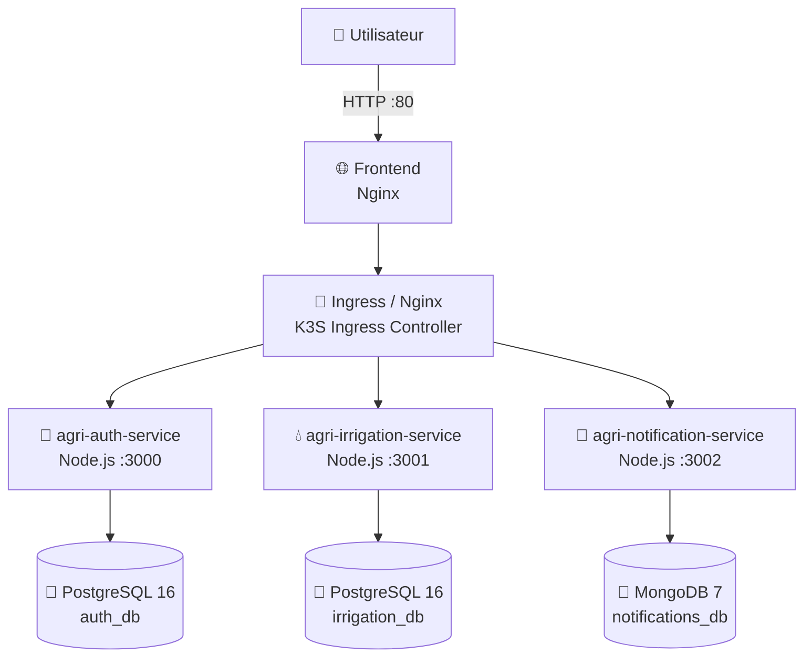

# 🌱 AgriIrrigation — Plateforme de Gestion Intelligente de l'Irrigation


---

## 📋 Description

**AgriIrrigation** est une application **full-stack microservices** dédiée à la gestion intelligente de l'irrigation agricole. Elle permet aux agriculteurs de gérer leurs parcelles, planifier les arrosages, recevoir des alertes et s'authentifier de manière sécurisée — le tout orchestré via **Kubernetes (K3S)**.

Le projet suit une architecture microservices découplée : chaque service dispose de sa propre base de données, de son propre Dockerfile et de ses propres tests unitaires.

---

## 🏗️ Architecture

### Vue d'ensemble

```
┌─────────────────────────────────────────────────────────────┐
│                        UTILISATEUR                          │
└──────────────────────────┬──────────────────────────────────┘
                           │ HTTP (port 80)
                           ▼
                ┌─────────────────────┐
                │  Frontend (Nginx)   │
                │  HTML / CSS / JS    │
                └──────────┬──────────┘
                           │
                  ┌────────▼────────┐
                  │  Ingress/Nginx  │  (K3S Ingress Controller)
                  └────────┬────────┘
                           │
          ┌────────────────┼────────────────┐
          ▼                ▼                ▼
┌──────────────┐  ┌──────────────┐  ┌──────────────────┐
│ auth-service │  │ irrigation-  │  │ notification-    │
│  (port 3000) │  │ service      │  │ service          │
│  Node.js /   │  │ (port 3001)  │  │ (port 3002)      │
│  Express     │  │ Node.js /    │  │ Node.js /        │
│              │  │ Express      │  │ Express          │
└──────┬───────┘  └──────┬───────┘  └────────┬─────────┘
       │                 │                   │
       ▼                 ▼                   ▼
┌────────────┐  ┌────────────────┐  ┌───────────────┐
│ PostgreSQL │  │  PostgreSQL    │  │   MongoDB 7   │
│  auth_db   │  │  irrigation_db │  │ notifications │
└────────────┘  └────────────────┘  └───────────────┘
```

### Schéma Mermaid



---

## 🛠️ Stack Technique

| Composant               | Technologie              | Version  | Rôle                                      |
|-------------------------|--------------------------|----------|-------------------------------------------|
| **Frontend**            | Nginx + HTML/CSS/JS      | 1.25     | Interface utilisateur statique            |
| **MS1 — Auth**          | Node.js / Express        | 20 LTS   | Authentification JWT, gestion utilisateurs|
| **MS2 — Irrigation**    | Node.js / Express        | 20 LTS   | Gestion parcelles & sessions d'arrosage  |
| **MS3 — Notification**  | Node.js / Express        | 20 LTS   | Alertes & notifications MongoDB           |
| **SQL Database**        | PostgreSQL               | 16       | Données auth et irrigation (relationnel)  |
| **NoSQL Database**      | MongoDB                  | 7        | Notifications (documentaire)              |
| **ORM/Driver SQL**      | pg (node-postgres)       | 8.x      | Connexion PostgreSQL                      |
| **ODM NoSQL**           | Mongoose                 | 8.x      | Connexion MongoDB                         |
| **Authentification**    | JSON Web Token (JWT)     | 9.x      | Sécurisation des APIs                     |
| **Chiffrement**         | bcryptjs                 | 2.x      | Hachage des mots de passe                 |
| **Containerisation**    | Docker                   | 24+      | Build & packaging des services            |
| **Orchestration**       | K3S (Kubernetes)         | v1.28+   | Déploiement et gestion des pods           |
| **CI/CD**               | GitHub Actions           | —        | Tests automatisés et build Docker         |
| **Tests**               | Jest + Supertest         | 29.x     | Tests unitaires et d'intégration          |

---

## ✅ Prérequis

Avant de commencer, assurez-vous d'avoir installé :

| Outil            | Version minimale | Lien                                          |
|------------------|-----------------|-----------------------------------------------|
| **Git**          | 2.x             | https://git-scm.com/                         |
| **Docker**       | 24.x            | https://docs.docker.com/get-docker/           |
| **Docker Compose**| 2.x            | https://docs.docker.com/compose/install/      |
| **kubectl**      | 1.28+           | https://kubernetes.io/docs/tasks/tools/       |
| **K3S**          | v1.28+          | https://k3s.io/                               |
| **Node.js**      | 20 LTS          | https://nodejs.org/ (optionnel, pour dev local)|

---

## 🚀 Démarrage Rapide (Docker Compose)

### 1. Cloner le dépôt

```bash
git clone https://github.com/ferid-saad/agri-irrigation-final-project-k8s.git
cd agri-irrigation-final-project-k8s
```

### 2. Lancer tous les services

```bash
docker-compose up --build
```

### 3. Accéder à l'application

Ouvrez votre navigateur sur : **http://localhost**

> Les services sont disponibles sur :
> - Frontend : http://localhost
> - Auth Service : http://localhost:3000
> - Irrigation Service : http://localhost:3001
> - Notification Service : http://localhost:3002

### 4. Arrêter les services

```bash
docker-compose down
# Pour supprimer aussi les volumes (données) :
docker-compose down -v
```

---

## ☸️ Déploiement Kubernetes (K3S)

### 1. Installer K3S

```bash
curl -sfL https://get.k3s.io | sh -
# Vérifier l'installation
kubectl get nodes
```

### 2. Builder et pousser les images Docker


```bash
docker build -t feridsaad/agri-auth-service:latest ./agri-auth-service
docker build -t feridsaad/agri-irrigation-service:latest ./agri-irrigation-service
docker build -t feridsaad/agri-notification-service:latest ./agri-notification-service
docker build -t feridsaad/agri-frontend:latest ./agri-frontend

docker push feridsaad/agri-auth-service:latest
docker push feridsaad/agri-irrigation-service:latest
docker push feridsaad/agri-notification-service:latest
docker push feridsaad/agri-frontend:latest
```

### 3. Déployer sur K3S

```bash
# Namespace dédié
kubectl apply -f k8s/namespace.yaml

# Secrets et configuration
kubectl apply -f k8s/secrets.yaml
kubectl apply -f k8s/configmap.yaml

# Bases de données
kubectl apply -f k8s/postgres/
kubectl apply -f k8s/mongodb/

# Microservices
kubectl apply -f k8s/auth-service/
kubectl apply -f k8s/irrigation-service/
kubectl apply -f k8s/notification-service/

# Frontend et exposition
kubectl apply -f k8s/frontend/
kubectl apply -f k8s/ingress.yaml

# Politiques réseau et disponibilité
kubectl apply -f k8s/network-policy.yaml
kubectl apply -f k8s/pdb.yaml
```

### 4. Vérifier le déploiement

```bash
# Voir tous les ressources dans le namespace
kubectl get all -n agri-irrigation

# Voir les pods en détail
kubectl get pods -n agri-irrigation -o wide

# Voir les logs d'un service
kubectl logs -f deployment/agri-auth-service -n agri-irrigation

# Voir les événements
kubectl get events -n agri-irrigation --sort-by='.lastTimestamp'
```

---

## 📡 API Endpoints

### 🔐 MS1 — agri-auth-service (port 3000)

| Méthode | Endpoint            | Auth requise | Description                        |
|---------|--------------------|--------------|------------------------------------|
| `GET`   | `/health`          | ❌           | Health check du service            |
| `POST`  | `/auth/register`   | ❌           | Créer un nouveau compte utilisateur|
| `POST`  | `/auth/login`      | ❌           | Se connecter, retourne un JWT      |
| `GET`   | `/auth/me`         | ✅ Bearer    | Récupérer son profil               |

**Exemple — Register :**
```bash
curl -X POST http://localhost:3000/auth/register \
  -H "Content-Type: application/json" \
  -d '{"email":"user@example.com","password":"secret123","nom":"Ahmed","prenom":"Ben Ali"}'
```

**Exemple — Login :**
```bash
curl -X POST http://localhost:3000/auth/login \
  -H "Content-Type: application/json" \
  -d '{"email":"user@example.com","password":"secret123"}'
```

---

### 💧 MS2 — agri-irrigation-service (port 3001)

| Méthode   | Endpoint                        | Auth requise | Description                       |
|-----------|---------------------------------|--------------|-----------------------------------|
| `GET`     | `/health`                       | ❌           | Health check du service           |
| `GET`     | `/parcelles`                    | ✅ Bearer    | Lister toutes les parcelles       |
| `POST`    | `/parcelles`                    | ✅ Bearer    | Créer une nouvelle parcelle       |
| `GET`     | `/parcelles/:id`                | ✅ Bearer    | Détail d'une parcelle             |
| `PUT`     | `/parcelles/:id`                | ✅ Bearer    | Modifier une parcelle             |
| `DELETE`  | `/parcelles/:id`                | ✅ Bearer    | Supprimer une parcelle            |
| `GET`     | `/arrosages`                    | ✅ Bearer    | Lister les sessions d'arrosage    |
| `POST`    | `/arrosages`                    | ✅ Bearer    | Créer une session d'arrosage      |
| `GET`     | `/arrosages/:id`                | ✅ Bearer    | Détail d'une session d'arrosage   |
| `PUT`     | `/arrosages/:id`                | ✅ Bearer    | Modifier une session d'arrosage   |
| `DELETE`  | `/arrosages/:id`                | ✅ Bearer    | Supprimer une session d'arrosage  |

---

### 🔔 MS3 — agri-notification-service (port 3002)

| Méthode   | Endpoint                        | Auth requise | Description                        |
|-----------|---------------------------------|--------------|------------------------------------|
| `GET`     | `/health`                       | ❌           | Health check du service            |
| `POST`    | `/notifications`                | ✅ Bearer    | Créer une notification             |
| `GET`     | `/notifications`                | ✅ Bearer    | Lister ses notifications           |
| `PATCH`   | `/notifications/:id/lu`         | ✅ Bearer    | Marquer une notification comme lue |
| `DELETE`  | `/notifications/:id`            | ✅ Bearer    | Supprimer une notification         |

---

## 🏆 Bonnes Pratiques Kubernetes Appliquées

| Pratique                              | Description                                                           |
|---------------------------------------|-----------------------------------------------------------------------|
| **Namespace dédié**                   | Isolation dans le namespace `agri-irrigation`                        |
| **Secrets Kubernetes**                | Mots de passe et JWT_SECRET stockés dans des `Secret` K8s (non en clair) |
| **ConfigMaps**                        | Variables de configuration découplées du code                        |
| **Resource Requests & Limits**        | CPU et mémoire limitées pour éviter la saturation du nœud            |
| **Liveness & Readiness Probes**       | Health checks automatiques via `/health` endpoints                   |
| **Rolling Updates**                   | Mise à jour sans interruption de service (`RollingUpdate` strategy)  |
| **PodDisruptionBudget (PDB)**         | Garantie de disponibilité minimale durant les maintenances           |
| **Network Policies**                  | Filtrage réseau entre pods (principe du moindre privilège)           |
| **Persistent Volumes (PVC)**          | Données PostgreSQL et MongoDB persistées sur disque                  |
| **Non-root containers**               | Les conteneurs exécutent leur processus principal avec un utilisateur non privilégié (autre que l'utilisateur root)|
| **RBAC**                               | moindre privilège — chaque SA n'accède qu'aux ressources strictement nécessaires, avec automountServiceAccountToken: false.            |
| **Image tagging**                     | Tags versionnés sur les images (`:latest` pour dev, semver pour prod)|
| **Multi-replica deployments**         | Plusieurs réplicas pour la haute disponibilité                       |
| **Ingress Controller**                | Point d'entrée unique avec routage par chemin                        |
| **Horizontal scaling ready**          | Architecture prête pour l'HPA (Horizontal Pod Autoscaler)            |

---

## 📁 Structure du Projet

```
agri-irrigation/
├── 📄 docker-compose.yml              # Orchestration locale Docker Compose
├── 📄 init-db.sql                     # Scripts d'initialisation SQL
├── 📄 .gitignore
│
├── 📂 agri-auth-service/              # MS1 — Service d'authentification
│   ├── 📄 Dockerfile
│   ├── 📄 package.json
│   ├── 📄 package-lock.json
│   ├── 📄 .dockerignore
│   ├── 📄 .gitignore
│   ├── 📂 src/
│   │   ├── 📄 app.js                  # Express app + routes
│   │   ├── 📄 server.js               # Point d'entrée
│   │   ├── 📄 db.js                   # Connexion PostgreSQL
│   │   ├── 📂 middleware/
│   │   │   └── 📄 auth.js             # Middleware JWT
│   │   └── 📂 routes/
│   │       └── 📄 auth.js             # Routes /auth/*
│   └── 📂 tests/
│       └── 📄 auth.test.js
│
├── 📂 agri-irrigation-service/        # MS2 — Service irrigation
│   ├── 📄 Dockerfile
│   ├── 📄 package.json
│   ├── 📄 package-lock.json
│   ├── 📄 .dockerignore
│   ├── 📂 src/
│   │   ├── 📄 app.js
│   │   ├── 📄 server.js
│   │   ├── 📄 db.js
│   │   ├── 📂 middleware/
│   │   │   └── 📄 auth.js
│   │   └── 📂 routes/
│   │       ├── 📄 parcelles.js        # Routes /parcelles/*
│   │       └── 📄 arrosages.js        # Routes /arrosages/*
│   └── 📂 tests/
│       ├── 📄 health.test.js
│       ├── 📄 parcelles.test.js
│       └── 📄 arrosages.test.js
│
├── 📂 agri-notification-service/      # MS3 — Service notifications
│   ├── 📄 Dockerfile
│   ├── 📄 package.json
│   ├── 📄 .dockerignore
│   ├── 📂 src/
│   │   ├── 📄 app.js
│   │   ├── 📄 server.js
│   │   ├── 📄 db.js                   # Connexion MongoDB
│   │   ├── 📂 middleware/
│   │   │   └── 📄 auth.js
│   │   ├── 📂 models/
│   │   │   └── 📄 Notification.js     # Schéma Mongoose
│   │   └── 📂 routes/
│   │       └── 📄 notifications.js
│   └── 📂 tests/
│
├── 📂 agri-frontend/                  # Frontend statique Nginx
│   ├── 📄 Dockerfile
│   ├── 📄 nginx.conf
│   ├── 📄 .dockerignore
│   └── 📂 public/
│       ├── 📄 index.html
│       ├── 📄 style.css
│       └── 📄 app.js
│
├── 📂 k8s/                            # Manifestes Kubernetes
│   ├── 📄 namespace.yaml
│   ├── 📄 secrets.yaml
│   ├── 📄 configmap.yaml
│   ├── 📄 ingress.yaml
│   ├── 📄 network-policy.yaml
│   ├── 📄 pdb.yaml
│   ├── 📂 postgres/
│   │   ├── 📄 deployment.yaml
│   │   ├── 📄 service.yaml
│   │   └── 📄 pvc.yaml
│   ├── 📂 mongodb/
│   │   ├── 📄 deployment.yaml
│   │   ├── 📄 service.yaml
│   │   └── 📄 pvc.yaml
│   ├── 📂 auth-service/
│   │   ├── 📄 deployment.yaml
│   │   └── 📄 service.yaml
│   ├── 📂 irrigation-service/
│   │   ├── 📄 deployment.yaml
│   │   └── 📄 service.yaml
│   ├── 📂 notification-service/
│   │   ├── 📄 deployment.yaml
│   │   └── 📄 service.yaml
│   └── 📂 frontend/
│       ├── 📄 deployment.yaml
│       └── 📄 service.yaml
│
├── 📂 captures/                       # Captures d'écran du projet
│
└── 📂 .github/
    └── 📂 workflows/
        └── 📄 ci.yml                  # Pipeline CI GitHub Actions
```

---

## 🧪 Lancer les Tests

### Tests locaux (par service)

```bash
# MS1 — Auth Service
cd agri-auth-service
npm install
npm test

# MS2 — Irrigation Service
cd agri-irrigation-service
npm install
npm test

# MS3 — Notification Service
cd agri-notification-service
npm install
npm test
```

### Tests avec variables d'environnement

```bash
# Auth Service avec PostgreSQL local
DB_HOST=localhost DB_PORT=5433 DB_USER=agri DB_PASSWORD=agri123 \
DB_NAME=auth_db JWT_SECRET=test-secret npm test

# Notification Service avec MongoDB local
MONGODB_URI=mongodb://localhost:27017/test_notifications \
JWT_SECRET=test-secret npm test
```

### CI/CD — GitHub Actions

Chaque `push` ou `pull_request` sur `main` ou `develop` déclenche automatiquement le pipeline CI qui :

1. ✅ Lance les tests de `agri-auth-service` (avec PostgreSQL en service)
2. ✅ Lance les tests de `agri-irrigation-service` (avec PostgreSQL en service)
3. ✅ Lance les tests de `agri-notification-service` (avec MongoDB en service)
4. 🐳 Build les 4 images Docker (si tous les tests passent)

---

## 🤝 Contribution

1. Forker le dépôt
2. Créer une branche feature : `git checkout -b feature/ma-fonctionnalite`
3. Committer vos changements : `git commit -m 'feat: ajout ma fonctionnalité'`
4. Pousser la branche : `git push origin feature/ma-fonctionnalite`
5. Ouvrir une Pull Request vers `develop`


<div align="center">

**🌱 AgriIrrigation** — Développé dans le cadre du projet DevOps 2027  
Auteur : **Ferid Saad**

</div>
