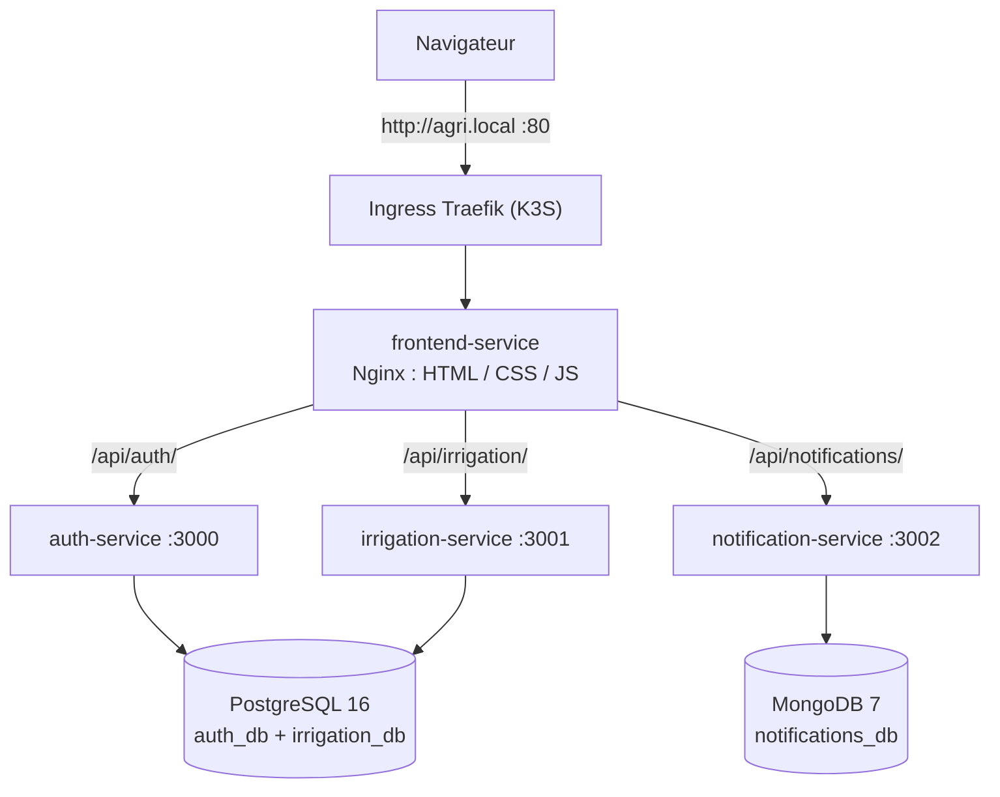

# AgriIrrigation : gestion de l'irrigation agricole sur Kubernetes (K3S)


Application **full stack en microservices** : un frontend, trois microservices et deux types de bases de données (SQL et NoSQL), conteneurisée avec Docker et déployée sur un cluster **K3S** en appliquant les bonnes pratiques Kubernetes.

Projet réalisé dans le cadre du Master DevOps & Cloud (ISET Tozeur). Auteur : **Ferid Saad**.

Dépôt : https://github.com/ferid-saad/agri-irrigation-final-project-k8s

---

## 1. Fonctionnalités

Un agriculteur peut :

- créer un compte et se connecter (authentification JWT) ;
- gérer ses **parcelles** (nom, surface en hectares, culture) ;
- **planifier des arrosages** (date, durée, volume prévu) et saisir la **consommation réelle**, avec calcul de l'écart ;
- recevoir des **notifications** :
  - *succès* à chaque arrosage planifié, avec la parcelle, la date, la durée et le volume ;
  - *alerte* quand la consommation réelle dépasse de plus de 10 % le volume prévu ;
  - marquer une notification comme lue ou la supprimer.

---

## 2. Correspondance avec la consigne

| Exigence | Réalisation |
|---|---|
| Un service frontend | `agri-frontend` : Nginx servant HTML / CSS / JS, et proxy vers les APIs |
| Trois microservices | `agri-auth-service`, `agri-irrigation-service`, `agri-notification-service` (Node.js / Express) |
| Base SQL | PostgreSQL 16 (`auth_db`, `irrigation_db`) |
| Base NoSQL | MongoDB 7 (`notifications_db`) |
| Conteneurisation | Un Dockerfile par service, `docker-compose.yml` pour le développement local |
| Déploiement sur K3S | Manifestes dans `k8s/` |
| Bonnes pratiques Kubernetes | Voir la section 6 |

---

## 3. Architecture



Principes :

- **Un seul point d'entrée** : l'Ingress envoie tout le trafic au frontend. Le Nginx du frontend redirige `/api/auth/`, `/api/irrigation/` et `/api/notifications/` vers les microservices.
- **Une base par domaine** : l'authentification et l'irrigation utilisent des bases PostgreSQL distinctes ; les notifications, de nature documentaire, utilisent MongoDB.
- **JWT partagé** : chaque service valide lui-même le token avec le même secret, sans appeler le service d'authentification.
- **Isolation réseau** : les NetworkPolicies n'autorisent que les flux nécessaires (section 6).

---

## 4. Stack technique

| Composant | Technologie |
|---|---|
| Frontend | Nginx 1.25 (Alpine), HTML / CSS / JavaScript |
| Microservices | Node.js 20, Express |
| Authentification | JSON Web Token, bcryptjs |
| Base SQL | PostgreSQL 16 (driver `pg`) |
| Base NoSQL | MongoDB 7 (Mongoose) |
| Conteneurs | Docker, Docker Compose |
| Orchestration | K3S (Kubernetes), Ingress Traefik |
| Registre d'images | Docker Hub (`feridsaad/agri-*`) |

---

## 5. Structure du dépôt

```
.
├── docker-compose.yml          # Exécution locale
├── init-db.sql                 # Création des bases auth_db et irrigation_db
├── .env.example                # Modèle de configuration (valeurs factices)
├── agri-auth-service/          # Microservice d'authentification
├── agri-irrigation-service/    # Microservice parcelles et arrosages
├── agri-notification-service/  # Microservice notifications (MongoDB)
├── agri-frontend/              # Nginx + interface web
│   ├── nginx.conf
│   └── public/                 # index.html, style.css, app.js
├── k8s/
│   ├── namespace.yaml
│   ├── rbac.yaml               # ServiceAccounts, Roles, RoleBindings
│   ├── configmap.yaml          # ConfigMap agri-config
│   ├── ingress.yaml            # Ingress Traefik
│   ├── network-policy.yaml     # 13 NetworkPolicies
│   ├── pdb.yaml                # PodDisruptionBudgets
│   ├── postgres/               # Deployment, Service, PVC, init
│   ├── mongodb/                # Deployment, Service, PVC
│   ├── auth-service/           # Deployment, Service, HPA
│   ├── irrigation-service/     # Deployment, Service, HPA
│   ├── notification-service/   # Deployment, Service, HPA
│   └── frontend/               # Deployment, Service, HPA
└── captures/                   # Captures d'écran du projet
```

---

## 6. Bonnes pratiques Kubernetes appliquées

| Pratique | Mise en œuvre |
|---|---|
| **Namespace dédié** | `agri-irrigation` : isolation des ressources |
| **ConfigMap** | `agri-config` : hôtes, ports et noms de bases, séparés du code |
| **Secret** | `agri-secrets` : mots de passe des bases et secret JWT, **créé par commande, jamais versionné** |
| **ServiceAccounts + RBAC** | Un ServiceAccount, un Role et un RoleBinding par composant (`k8s/rbac.yaml`) |
| **Requests et limits** | Ressources CPU / mémoire déclarées dans les Deployments |
| **Probes** | Liveness / readiness sur `/health` pour les services ; MongoDB avec startupProbe, liveness TCP et readiness `mongosh` |
| **Haute disponibilité** | 2 réplicas minimum pour le frontend et les trois microservices |
| **HPA** | Mise à l'échelle automatique sur le CPU (seuil 70 %), de 2 à 5 pods (2 à 4 pour le frontend) |
| **PodDisruptionBudget** | `minAvailable: 1` pour le frontend et les trois microservices |
| **NetworkPolicies** | `default-deny-all`, DNS autorisé, puis uniquement les flux nécessaires : Ingress → frontend, frontend → services, services → leur base |
| **Persistance** | PVC `local-path` de 2 Gi pour PostgreSQL et MongoDB |
| **Rolling updates** | Stratégie `RollingUpdate` (par défaut des Deployments) : mise à jour sans interruption |
| **Ingress** | Point d'entrée unique, routage par nom d'hôte (`agri.local`) |
| **Secrets hors Git** | `.env` ignoré par Git, `.env.example` fourni, Secret Kubernetes créé sur le cluster |
| **Authentification des bases** | PostgreSQL et MongoDB protégés par mot de passe, y compris en local |

---

## 7. Lancer en local (Docker Compose)

### Prérequis

Git, Docker Desktop (ou Docker Engine) avec Docker Compose v2.

### Étapes

```bash
git clone https://github.com/ferid-saad/agri-irrigation-final-project-k8s.git
cd agri-irrigation-final-project-k8s
cp .env.example .env        # PowerShell : Copy-Item .env.example .env
```

Éditez `.env` et remplacez les valeurs `CHANGEME_...`. Pour les mots de passe, utilisez uniquement des lettres et des chiffres (celui de MongoDB est placé dans une URL). `JWT_SECRET` doit faire au moins 32 caractères.

```bash
docker compose up --build -d
docker compose ps
```

Les six conteneurs doivent être `Up`, PostgreSQL et MongoDB en `healthy`. L'application est disponible sur **http://localhost**.

Seul le port 80 (frontend) est publié. Les APIs sont testables **à travers le frontend** :

```bash
curl http://localhost/api/auth/health
curl http://localhost/api/irrigation/health
curl http://localhost/api/notifications/health
```

Arrêt :

```bash
docker compose down        # conserve les données
docker compose down -v     # supprime aussi les volumes
```

> Si vous changez un mot de passe de base après un premier démarrage, supprimez les volumes (`down -v`) : les bases gardent le mot de passe défini à la création du volume.

---

## 8. Déployer sur K3S

### Prérequis

- un cluster K3S fonctionnel (`kubectl get nodes` : nœuds `Ready`) ;
- l'Ingress Traefik, installé par défaut avec K3S ;
- les images publiées sur Docker Hub (étape 1).

### Étape 1 : construire et publier les images (poste de développement)

```bash
docker login
for s in auth-service irrigation-service notification-service frontend; do
  docker build -t feridsaad/agri-$s:latest ./agri-$s
  docker push feridsaad/agri-$s:latest
done
```

Sous PowerShell, répétez `docker build` et `docker push` pour chacun des quatre services.

### Étape 2 : récupérer le dépôt sur le master

Seuls les manifestes du dossier `k8s/` sont nécessaires sur le cluster ; les nœuds téléchargent les images depuis Docker Hub.

```bash
git clone https://github.com/ferid-saad/agri-irrigation-final-project-k8s.git
cd agri-irrigation-final-project-k8s
```

### Étape 3 : namespace, RBAC, Secret et ConfigMap

```bash
kubectl apply -f k8s/namespace.yaml
kubectl apply -f k8s/rbac.yaml

kubectl create secret generic agri-secrets -n agri-irrigation \
  --from-literal=postgres-user=agri \
  --from-literal=postgres-password="$(openssl rand -hex 12)" \
  --from-literal=jwt-secret="$(openssl rand -hex 32)" \
  --from-literal=mongo-user=agri_mongo \
  --from-literal=mongo-password="$(openssl rand -hex 12)"

kubectl apply -f k8s/configmap.yaml
```

Le Secret est généré aléatoirement directement sur le cluster : aucune valeur n'est écrite dans un fichier. Le fichier modèle de Secret du dépôt ne contient que des valeurs factices : **ne l'appliquez pas**.

> Ne recréez pas le Secret après le déploiement des bases : PostgreSQL et MongoDB gardent le mot de passe d'origine dans leur volume.

### Étape 4 : bases de données

```bash
kubectl apply -f k8s/postgres/
kubectl apply -f k8s/mongodb/
kubectl wait --for=condition=Ready pod -l app=postgres -n agri-irrigation --timeout=180s
kubectl wait --for=condition=Ready pod -l app=mongodb -n agri-irrigation --timeout=180s
```

### Étape 5 : microservices, frontend et Ingress

```bash
kubectl apply -f k8s/auth-service/
kubectl apply -f k8s/irrigation-service/
kubectl apply -f k8s/notification-service/
kubectl apply -f k8s/frontend/
kubectl apply -f k8s/ingress.yaml
```

### Étape 6 : disponibilité et isolation réseau

À appliquer **en dernier**, une fois l'application validée :

```bash
kubectl apply -f k8s/pdb.yaml
kubectl apply -f k8s/network-policy.yaml
```

Pour revenir en arrière en cas de blocage : `kubectl delete -f k8s/network-policy.yaml`.

### Étape 7 : vérifier

```bash
kubectl get pods,svc,ingress,hpa,pdb,pvc -n agri-irrigation
kubectl get networkpolicy -n agri-irrigation
```

Tous les pods doivent être `1/1 Running`, les deux PVC `Bound`.

Test depuis le master, sans modifier le fichier `hosts` :

```bash
curl -s -o /dev/null -w "frontend: %{http_code}\n" -H "Host: agri.local" http://127.0.0.1/
curl -s -H "Host: agri.local" http://127.0.0.1/api/auth/health
curl -s -H "Host: agri.local" http://127.0.0.1/api/irrigation/health
curl -s -H "Host: agri.local" http://127.0.0.1/api/notifications/health
```

### Étape 8 : accéder à l'application depuis votre poste

Récupérez l'adresse IP du master (`kubectl get nodes -o wide`) et ajoutez-la au fichier `hosts` :

- Windows : `C:\Windows\System32\drivers\etc\hosts` (éditeur lancé en administrateur)
- Linux / macOS : `/etc/hosts`

```
192.168.56.10  agri.local
```

(remplacez l'IP par celle de votre master). Ouvrez ensuite **http://agri.local**.

### Mettre à jour un service

```bash
docker build -t feridsaad/agri-frontend:latest ./agri-frontend
docker push feridsaad/agri-frontend:latest
kubectl rollout restart deployment/frontend -n agri-irrigation
kubectl rollout status deployment/frontend -n agri-irrigation
```

---

## 9. API

Depuis le navigateur ou `curl`, les chemins passent par le frontend : `/api/<service>/...`. Nginx retire le préfixe `/api/<service>` avant de transmettre la requête au service.

### Authentification : `/api/auth/` (service sur le port 3000)

| Méthode | Chemin (via le frontend) | Auth | Description |
|---|---|---|---|
| `GET` | `/api/auth/health` | non | État du service |
| `POST` | `/api/auth/register` | non | Crée un compte. Corps : `{"email", "password"}` (mot de passe de 6 caractères minimum). Réponse `201` : `{"id", "email"}` |
| `POST` | `/api/auth/login` | non | Connexion. Corps : `{"email", "password"}`. Réponse : `{"token"}` |

### Irrigation : `/api/irrigation/` (service sur le port 3001)

| Méthode | Chemin | Auth | Description |
|---|---|---|---|
| `GET` | `/api/irrigation/health` | non | État du service |
| `GET` | `/api/irrigation/parcelles` | Bearer | Liste des parcelles |
| `POST` | `/api/irrigation/parcelles` | Bearer | Crée une parcelle : `{"nom", "surface_ha", "culture"}` |
| `DELETE` | `/api/irrigation/parcelles/:id` | Bearer | Supprime une parcelle et ses arrosages |
| `GET` | `/api/irrigation/arrosages` | Bearer | Liste des arrosages (avec le nom de la parcelle) |
| `POST` | `/api/irrigation/arrosages` | Bearer | Planifie un arrosage : `{"parcelle_id", "date_arrosage", "duree_min", "volume_l"}` |
| `PATCH` | `/api/irrigation/arrosages/:id` | Bearer | Enregistre la consommation réelle : `{"volume_reel_l"}` |

### Notifications : `/api/notifications/` (service sur le port 3002)

| Méthode | Chemin | Auth | Description |
|---|---|---|---|
| `GET` | `/api/notifications/health` | non | État du service |
| `GET` | `/api/notifications/notifications` | Bearer | Notifications de l'utilisateur, les plus récentes d'abord |
| `POST` | `/api/notifications/notifications` | Bearer | Crée une notification : `{"type": "alerte" \| "info" \| "succes", "message", "parcelleId"}` |
| `PATCH` | `/api/notifications/notifications/:id/lu` | Bearer | Marque comme lue |
| `DELETE` | `/api/notifications/notifications/:id` | Bearer | Supprime |

L'identifiant de l'utilisateur est lu dans le JWT : chacun ne voit que ses propres notifications.

### Exemple

```bash
curl -X POST http://agri.local/api/auth/register \
  -H "Content-Type: application/json" \
  -d '{"email":"user@example.com","password":"secret123"}'

TOKEN=$(curl -s -X POST http://agri.local/api/auth/login \
  -H "Content-Type: application/json" \
  -d '{"email":"user@example.com","password":"secret123"}' | jq -r .token)

curl -X POST http://agri.local/api/irrigation/parcelles \
  -H "Authorization: Bearer $TOKEN" -H "Content-Type: application/json" \
  -d '{"nom":"Parcelle Nord","surface_ha":5,"culture":"oliviers"}'

curl http://agri.local/api/notifications/notifications -H "Authorization: Bearer $TOKEN"
```

---

## 10. Démonstration

### Isolation réseau (moindre privilège)

Un pod sans label ne doit pas atteindre PostgreSQL :

```bash
kubectl run np-test --rm -i --restart=Never -n agri-irrigation --image=busybox \
  -- nc -zv -w 3 postgres-service 5432
```

Résultat attendu : délai dépassé. Un pod portant le label du frontend atteint l'authentification :

```bash
kubectl run np-test2 --rm -i --restart=Never -n agri-irrigation --labels=app=frontend \
  --image=curlimages/curl -- curl -s --max-time 5 http://auth-service:3000/health
```

Résultat attendu : `{"status":"ok","service":"auth-service"}`.

### Résilience

```bash
kubectl delete pod -n agri-irrigation -l app=auth-service --wait=false
kubectl get pods -n agri-irrigation -l app=auth-service -w
```

Le Deployment recrée le pod pendant que le second réplica continue de servir les requêtes.

### Persistance

Supprimez le pod PostgreSQL (`kubectl delete pod -n agri-irrigation -l app=postgres`), attendez son retour : les comptes et les parcelles sont toujours présents, car les données sont sur un PVC.

---

## 11. Tests et intégration continue

Les services d'authentification et d'irrigation disposent de tests Jest et Supertest :

```bash
cd agri-auth-service && npm install && npm test
cd ../agri-irrigation-service && npm install && npm test
```

Ces tests ont besoin d'une base PostgreSQL accessible (variables `DB_*` et `JWT_SECRET`). Un workflow GitHub Actions (`.github/workflows/ci.yml`) exécute les tests et construit les images Docker à chaque `push` ou `pull_request`.

---

## 12. Captures d'écran

| Capture | Fichier |
|---|---|
| Application sur `agri.local` (parcelles, arrosages) | `captures/app-agri-local.png` |
| Notifications (succès et alerte) | `captures/notifications.png` |
| Ressources du namespace | `captures/kubectl-get-all.png` |
| Ingress, HPA, PDB, PVC, NetworkPolicies | `captures/kubectl-ressources.png` |
| Test d'isolation réseau | `captures/network-policy-test.png` |
| Images sur Docker Hub | `captures/dockerhub.png` |


---

## 13. Dépannage

| Symptôme | Cause probable | Solution |
|---|---|---|
| `ImagePullBackOff` | Nom d'image ou de compte Docker Hub erroné, dépôt privé | Vérifier `image:` dans les Deployments (`feridsaad/...`) et rendre les dépôts publics |
| `password authentication failed` | Secret recréé après la création des volumes | Supprimer les PVC des bases et redéployer (les données sont perdues) |
| MongoDB redémarre en boucle | Sondes trop strictes pour `mongosh` | Utiliser la startupProbe et la liveness TCP fournies dans `k8s/mongodb/deployment.yaml` |
| `502 Bad Gateway` en local après un redémarrage de Docker | Les bases ne sont pas relancées, ou Nginx a gardé une ancienne adresse | `docker compose up -d`, puis `docker compose restart agri-frontend` |
| `agri.local` inaccessible | Entrée `hosts` absente ou erronée | Vérifier l'IP du master et le fichier `hosts` |
| Site inaccessible après les NetworkPolicies | Un pod n'a pas le label `app: <nom>` attendu | `kubectl get pods -n agri-irrigation --show-labels`, ou `kubectl delete -f k8s/network-policy.yaml` |

---

## 14. Limites connues et perspectives

- **Création du schéma SQL au démarrage** : lorsque deux réplicas démarrent en même temps sur une base vide, l'un peut échouer sur un conflit de création de tables puis redémarrer une fois. À terme, un Job de migration ou un `initContainer` exécuté une seule fois supprimerait ce cas.
- **Notifications émises par le navigateur** : le frontend crée les notifications après chaque action. Une architecture plus robuste ferait émettre l'événement par le service d'irrigation.
- **Valeur de repli du secret JWT** : le service d'authentification prévoit une valeur par défaut si `JWT_SECRET` est absent ; elle devrait être supprimée pour que le service refuse de démarrer sans secret.
- **Secrets Kubernetes** : ils sont seulement encodés en base64. En production, utiliser Sealed Secrets, External Secrets ou Vault.
- **Pas de TLS** sur l'Ingress : ajouter cert-manager et un certificat.
- **Bases de données en un seul réplica**, avec un stockage `local-path` lié à un nœud : prévoir un opérateur de base (réplication) et un stockage réseau.
- **`frontend-service` exposé en NodePort** en plus de l'Ingress : un `ClusterIP` suffirait.
- **Supervision** : ajouter Prometheus et Grafana pour les métriques et les alertes.

---

## 15. Auteur

**Ferid Saad** : Master DevOps & Cloud, ISET Tozeur.
